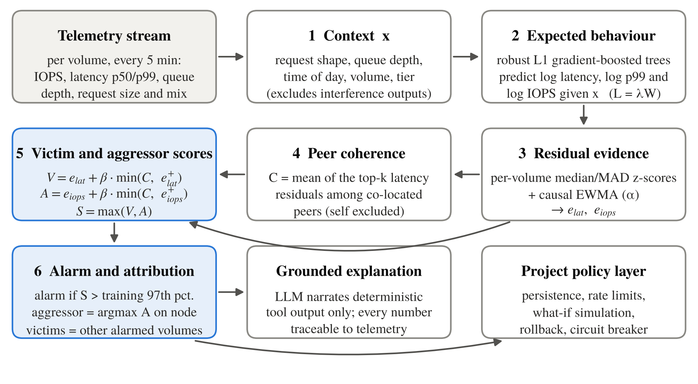
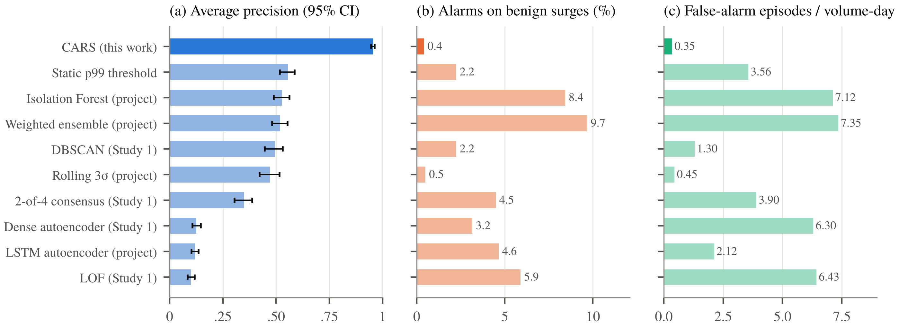
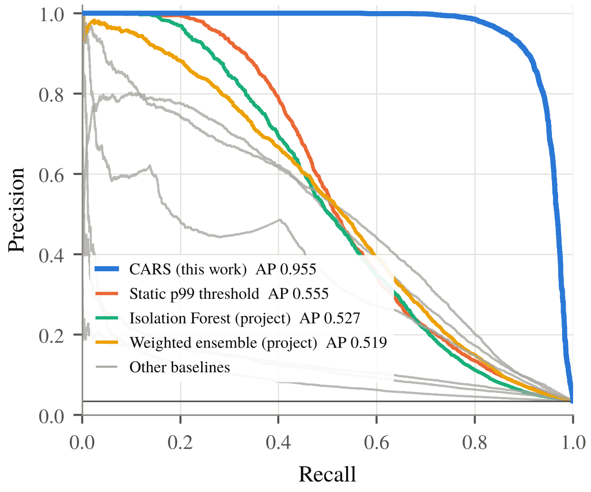
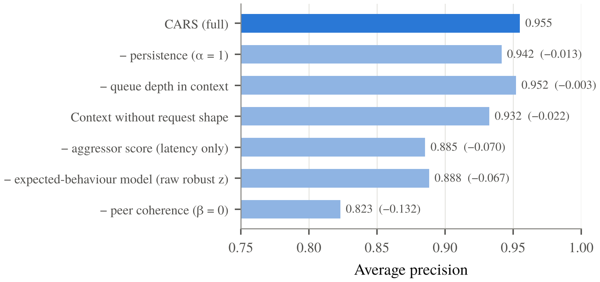

<div align="center">

# CARS: Contention-Aware Residual Scoring

### Detecting storage hotspots and attributing noisy neighbours in enterprise storage telemetry

Code, results and figures for the paper *"Not Every Spike Is a Hotspot: Contention-Aware Residual Scoring for Workload-Aware Hotspot Detection and Aggressor Attribution in Shared Storage"*




</div>

---

## The problem

In shared storage, one volume's burst of I/O can starve its neighbours on the same node. Operators need to know two things: **is this a real hotspot or a benign load surge?** and **who is the aggressor, and who are the victims?**

Most anomaly detectors only ask whether a reading is unusual. A nightly backup or an AI-training burst is unusual but harmless. A small latency rise that hits several co-located volumes at once is ordinary on its own but is the signature of contention. This makes generic detectors noisy and blind to who caused the problem.

## The idea

CARS scores how much a volume **deviates from what its own workload should produce**, and checks whether its **peers deviate at the same time**:

1. **Context.** Use request shape, queue depth, time of day, volume and tier. Outputs affected by interference are excluded.
2. **Expected behaviour.** Robust (L1) LightGBM regressors predict log latency, log p99 and log IOPS from that context. IOPS is conditioned on queue depth (Little's law, *L = λW*).
3. **Residual evidence.** Standardise each volume's residuals with its own median and MAD, then apply a causal EWMA for persistence. This gives *e<sub>lat</sub>* and *e<sub>iops</sub>*.
4. **Peer coherence.** *C* is the mean of the top-*k* latency residuals among co-located peers, excluding the volume itself.
5. **Scores.** The victim score is *V = e<sub>lat</sub> + β·min(C, e<sub>lat</sub><sup>+</sup>)*, the aggressor score is *A = e<sub>iops</sub> + β·min(C, e<sub>iops</sub><sup>+</sup>)*, and the hotspot score is *S = max(V, A)*.
6. **Alarm and attribution.** Alarm when *S* exceeds the 97th percentile seen in training. The aggressor is the volume with the highest *A* on the node, and the other alarmed volumes are the victims.

Every number CARS produces traces back to telemetry, so an LLM explanation layer can narrate it without inventing anything.

## Results

The benchmark has **432,000 telemetry rows** at 5-minute intervals over 30 days. Training covers days 1–21, hyperparameters are selected on days 15–21, and testing covers days 22–30. The test period has **153 injected noisy-neighbour events** with ground-truth aggressor and victim labels, plus benign load surges. The data comes from the HPE CPP team's generator, unchanged except that the generated labels are now recorded.



| Method | AP | ROC-AUC | F1 | Precision | Recall | Alarms on benign surges | False-alarm episodes / volume-day |
|---|---:|---:|---:|---:|---:|---:|---:|
| **CARS (this work)** | **0.955** | **0.992** | **0.901** | **0.961** | **0.848** | **0.4%** | **0.35** |
| Static p99 threshold | 0.555 | 0.882 | 0.526 | 0.558 | 0.498 | 2.2% | 3.56 |
| Isolation Forest (project) | 0.527 | 0.863 | 0.467 | 0.397 | 0.566 | 8.4% | 7.12 |
| Weighted ensemble (project) | 0.519 | 0.885 | 0.431 | 0.342 | 0.582 | 9.7% | 7.35 |
| DBSCAN | 0.495 | 0.908 | 0.479 | 0.710 | 0.362 | 2.2% | 1.30 |
| Rolling 3σ (project) | 0.471 | 0.904 | 0.278 | 0.782 | 0.169 | 0.5% | 0.45 |
| 2-of-4 consensus | 0.349 | 0.884 | 0.441 | 0.486 | 0.403 | 4.5% | 3.90 |
| Dense autoencoder | 0.126 | 0.764 | 0.172 | 0.191 | 0.156 | 3.2% | 6.30 |
| LSTM autoencoder (project) | 0.119 | 0.789 | 0.189 | 0.158 | 0.234 | 4.6% | 2.12 |
| LOF | 0.100 | 0.679 | 0.141 | 0.153 | 0.131 | 5.9% | 6.43 |

95% confidence intervals use a block bootstrap over (node, day) blocks. Full tables are in [`results/`](results/).

**Attribution.** CARS detects all 153 events and names the correct aggressor in **79.1%** of them. A naive "largest IOPS z-score on the node" rule manages 58.2%, and the project ensemble 3.9%. Victim recall is **85.3%** at 100% precision, compared with 65.5% for the project ensemble.

**Robustness.** CARS keeps a large lead when events are made subtler or only some neighbours are affected:

| Scenario | CARS AP | Best baseline AP |
|---|---:|---:|
| Base | 0.955 | 0.555 |
| Partial victims (34% of neighbours) | 0.918 | 0.444 |
| Subtle (1.15–1.4× latency and IOPS) | 0.596 | 0.143 |
| Subtle + partial | 0.343 | 0.066 |

**Ablations.** Removing **peer coherence** has the biggest effect: AP falls from 0.955 to 0.823, and alarms on benign surges rise from 0.4% to 11.7%. Removing the **residual model** lowers AP to 0.888. Queue-depth conditioning and persistence add smaller gains.

<p align="center">


</p>

## Repository

```
CARS-Storage-Hotspot-Detection/
├── cars/                       # research code: reproduces every number above
│   ├── paths.py                # all paths, overridable via environment variables
│   ├── common.py               # split, metrics, event recall, block bootstrap
│   ├── gen_labelled.py         # regenerate telemetry with ground-truth labels
│   ├── features.py             # project feature engineering
│   ├── run_baselines.py        # static, rolling 3σ, IF, LOF, DBSCAN
│   ├── run_cars.py             # CARS: selection, final fit, ablations, sensitivity
│   ├── run_nn.py               # dense AE, LSTM AE, project ensemble, consensus
│   ├── attribution.py          # aggressor / victim attribution
│   ├── aggregate.py            # result tables + bootstrap CIs
│   ├── fig_*.py                # paper figures
│   └── run_variants.sh         # robustness scenarios
├── results/                    # result tables (CSV/JSON) behind the figures
├── figures/                    # paper figures
├── pipeline/                   # end-to-end hotspot + noisy-neighbour pipeline (course project)
│   ├── hotspot_pipeline.py     # telemetry simulation, 4-detector consensus, attribution
│   ├── api.py                  # FastAPI: /hotspots, /explain/{node}, /ask, /noisy-neighbours
│   ├── noisy_neighbour_eval.py # attribution evaluation + ablation
│   ├── make_figures.py         # report figures (architecture, DFD, UML, results)
│   ├── tests/                  # 10 pytest checks, including the API
│   └── figures/
└── LICENSE
```

## Reproduce the research results

```bash
pip install -r cars/requirements.txt
git clone https://github.com/hpe-cpp2026-vit-vellore/IO-Workload-Pattern-Classification-Hotspot-Detection external/IO-Workload-Pattern-Classification-Hotspot-Detection

cd cars
python gen_labelled.py --out base      # 432,000 rows + 153 labelled events
python features.py base
python run_baselines.py base
python run_cars.py base
python run_nn.py base
python attribution.py base
python aggregate.py
./run_variants.sh                      # optional: subtle / partial / subtle_partial
```

The base results were re-run end to end from a clean clone while preparing this repository (AP 0.955, F1 0.901, matching the tables above). Generated data goes to `work/` by default. Set `CARS_DATA`, `CARS_OUT`, `CARS_FIG` or `CARS_PROJECT_REPO` to use other locations. All randomness is seeded.

## Run the course-project pipeline

```bash
cd pipeline
pip install -r requirements.txt
python hotspot_pipeline.py          # detect hotspots + noisy-neighbour events
python -m pytest -q tests           # 10 tests
uvicorn api:app --reload            # http://127.0.0.1:8000/docs
```

The pipeline combines Isolation Forest, LOF, DBSCAN and an autoencoder in a **≥2-of-4 consensus**. It then uses robust workload baselines to tell **aggressors**, **victims** and **node-local hotspots** apart. On the simulated benchmark, aggressor F1 is 0.95 and victim F1 is 0.89, and all 12 events are attributed to the correct culprit.

## Citation

```bibtex
@inproceedings{siddhanth2026cars,
  title  = {Not Every Spike Is a Hotspot: Contention-Aware Residual Scoring for Workload-Aware
            Hotspot Detection and Aggressor Attribution in Shared Storage},
  author = {Siddhanth, Sai},
  year   = {2026}
}
```

## Context

This work grew out of the **HPE India R&D Career Preview Program** (Feb–Jul 2026). In that program, a four-person team built an I/O workload classification and hotspot-detection platform: the [team repository](https://github.com/hpe-cpp2026-vit-vellore/IO-Workload-Pattern-Classification-Hotspot-Detection). My part was hotspot detection. CARS is my own follow-up research, which uses the team's telemetry generator as a fixed, independent benchmark. The pipeline is also my BCSE497J Project-I submission at VIT Vellore.

---

<div align="center">
<b>Sai Siddhanth</b> · B.Tech CSE (Data Science), VIT Vellore<br/>
<a href="https://www.linkedin.com/in/sai-siddhanth-67912628b">LinkedIn</a> · <a href="https://github.com/saisiddhanthks">GitHub</a>
</div>
